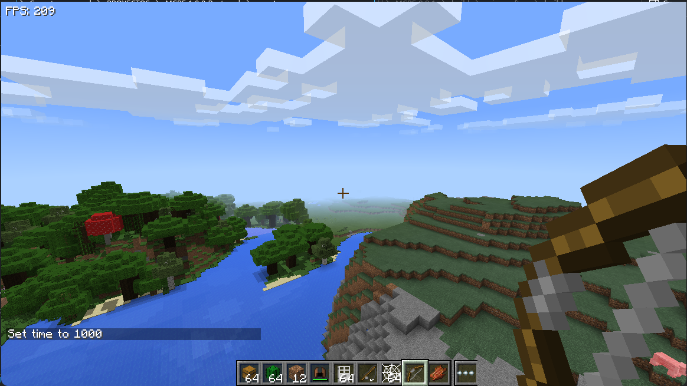
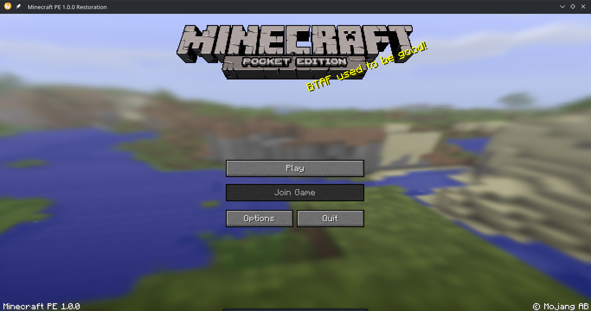
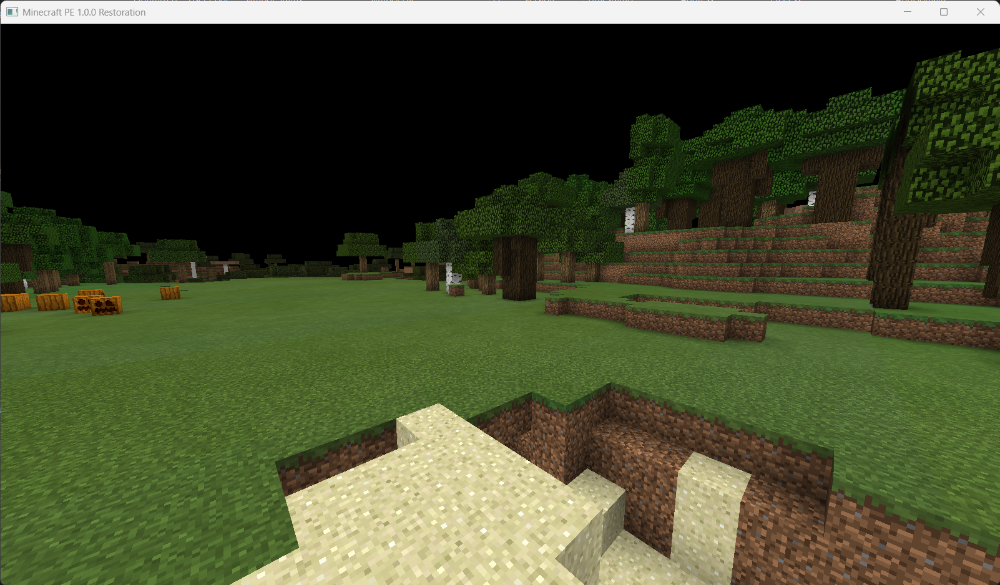
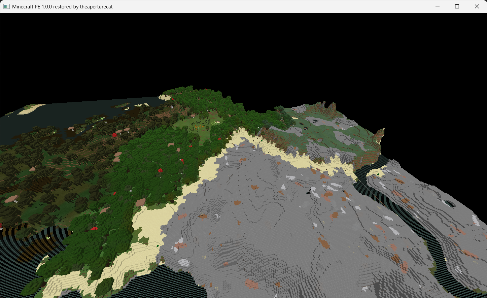
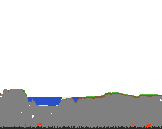
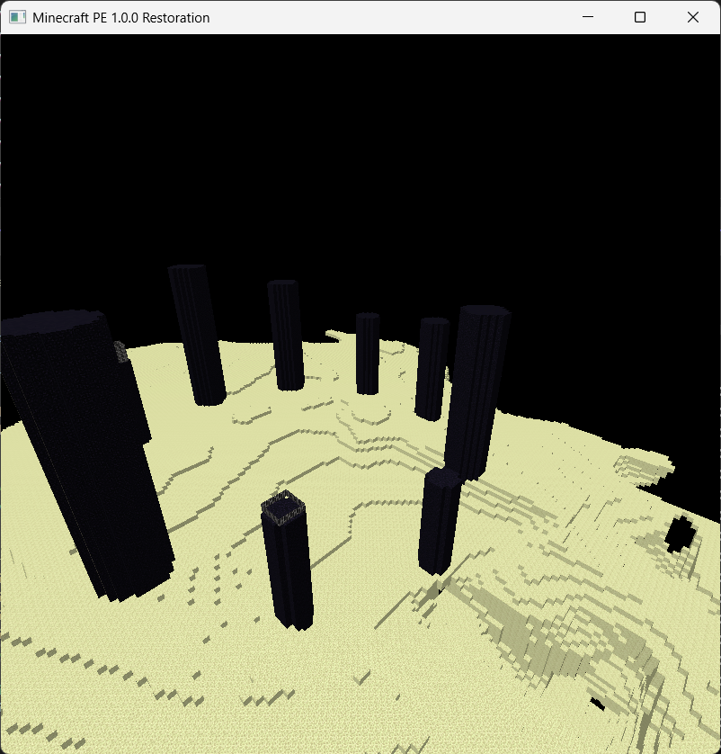

# Minecraft Pocket Edition 1.0.2.0 Code Restoration



This project aims to restore leaked MCPE 1.0.2.0 code from Minecraft Dungeons to working condition and make it playable on desktop platforms (Linux and Windows).

---

## Screenshots & Gallery

| In-Game View (Post-implementation of 0.8.1-0.12 code) | Main Menu / UI (Post-implementation of 0.8.1-0.12 code) |
| :---: | :---: |
|  |  |

| First Person View | Top-Down Renderer |
| :---: | :---: |
|  |  |

| Chunk Side Layer | The End |
| :---: | :---: |
|  |  |

---

## What Works (Current Progress)

- **Native Desktop Ports:** CMake + GLFW + GLAD support for Linux and Windows (`--console` mode for CLI).
- **Chunk Pipeline & Optimization:** Optimized chunk loading/unloading, meshing, lighting calculation (`WorldLighting`), database storage, and chunk pooling pipeline.
- **Rendering & Shaders:** Textured chunk rendering, transparent water, and loading real MCPE shaders + materials.
- **Dual GUI / UI System:** Live hot-switching (`useTouchUI`) supporting 1:1 MCPE 0.8.1 Touch layout and Classic PC layout (menus, world management, options, pause, chat, HUD/hotbar).
- **Crafting & Inventory:** Fully functional crafting & inventory systems for both PC (2x2 / 3x3 grids) and Touch MATTIS 0.8.1 (`PaneCraftingScreen`, `StonecutterScreen`, `ArmorScreen` with 3D Steve, `FurnaceScreen`, `ChestScreen`), including 3D isometric block rendering and 2D item rendering.
- **Gameplay & Physics:** Raycast block selection, breaking/placing blocks, player physics, AABB collisions, gravity, jump, fall damage, Creative flight toggle, and dropped `ItemEntity` physics/pickup.
- **Persistence & Options:** World, player, container, and modified chunk persistence (`WorldPersistence`), with full options persistence (`options.txt`, mouse sensitivity, render distance, difficulty, fancy skies/clouds).

---

## About the Code & Leak Origin
On March 1, 2026, a major Minecraft source code leak occurred, including Legacy Console edition code, PE 0.6.1 code, and the full Minecraft Dungeons development repository. 

The Dungeons codebase contained part of Pocket Edition 1.0.2.0 (dating to 2016-2017). However, the code was partially incomplete because key subsystems had been stripped out and replaced with Unreal Engine 4 code:
- **`lib-deps/Renderer`**: Removed due to Unreal renderer conflicts; shaders, models, and textures have been decompiled/recreated.
- **`src/platform`**: Platform abstraction removed for UE4; partially restored.
- **`network` / `world/entity` / `world/level/block/entity` / `redstone`**: Heavily removed or not yet restored.

---

## Interesting Code Artifacts
- **Farlands (`FarlandsFeature.cpp`):** Intentional farlands implementation (different from Java Edition), mentioned alongside 'underworlds' as chunk post-processing steps.
- **HoloLens Demo Code (`GameType.h`, `Player.h/cpp`):** Leftover code from the HoloLens E3 Minecraft demo, including lighting abilities and special 'viewer' gamemodes.

---

## How to Compile & Run

### Linux
1. Place the `resource_packs` (and assets) from Minecraft Pocket Edition 1.0.0 inside `assets/`.
2. Configure and build from the repository root:
   ```bash
   cmake -S handheld/src -B build
   cmake --build build -j$(nproc)
   rm -f assets/minecraftpe && mv build/minecraftpe assets/minecraftpe
   ```
3. Run from inside `assets/`:
   ```bash
   cd assets && ./minecraftpe
   ```

### Windows
1. Place the assets folder from MCPE 1.0.0 inside the data folder (do not overwrite; include `resource_packs`).
2. Use `build_win32.bat` in `handheld/src` to generate a Visual Studio solution.
3. Compile and launch, then type `render` to go straight to the renderer or use the console.

---

## Optimizations & Performance
- **Greedy Meshing System:** Lossless per-subchunk greedy meshing across opaque blocks, leaves, and still water at all LODs (`RenderChunkBuilder`), with a 1D `GL_TEXTURE_BUFFER` (`TEXTURE_3`) smooth-lighting cell buffer + 0-fetch uniform fast-path, exact per-cell isotropic/directional texture rotation in shaders, and live toggle via Touch/PC UI or the `O` key.
- **Rendering & FPS Pipeline:** Underground un-skylit cave subchunk culling, static GPU cloud VBO (`sCloudVbo`), VAO/texture/material state caching (`Mesh`, `RenderChunk`), entity/item frustum culling, and branchless shader fast-paths.
- **Chunk Builder Pipeline:** Re-engineered `RenderChunkBuilder` and `RenderChunk` to optimize vertex generation, meshing, and prioritize chunk updates around the player.
- **World Lighting:** Refactored light propagation (`WorldLighting`) to eliminate redundant calculations and reduce lag spikes during world generation and block updates.
- **Block Tessellator Cache:** Expanded `BlockTessellatorCache` to reuse geometry data and avoid recalculating identical block faces.
- **Rendering & Batching:** Improved mesh buffering and shader batching via `Mesh` and `renderer.cpp`, backed by `PerfTimer` telemetry.

---

## Current Limitations & Missing Features
- Online multiplayer / networking support is missing.
- Some items are not yet fully implemented.
- Certain block functionalities need completion.
- Ongoing rendering fixes and edge-case refinements.

---

## Contributing
Contributions are welcome! Create a pull request fixing an issue or restoring a feature. Try to reference Android builds near 1.0.2.0 with debug information when decompiling.
